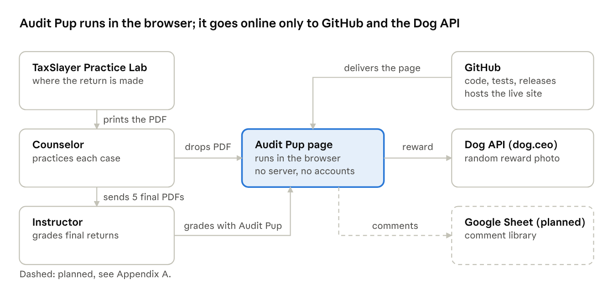
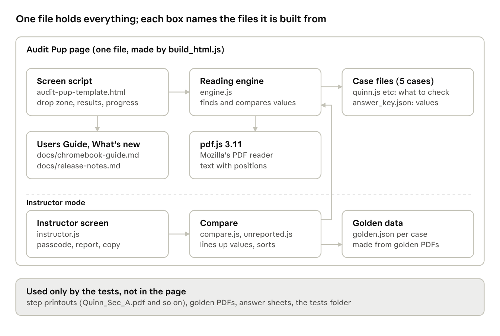
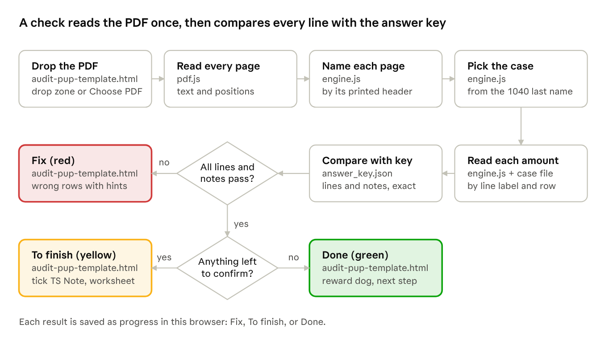
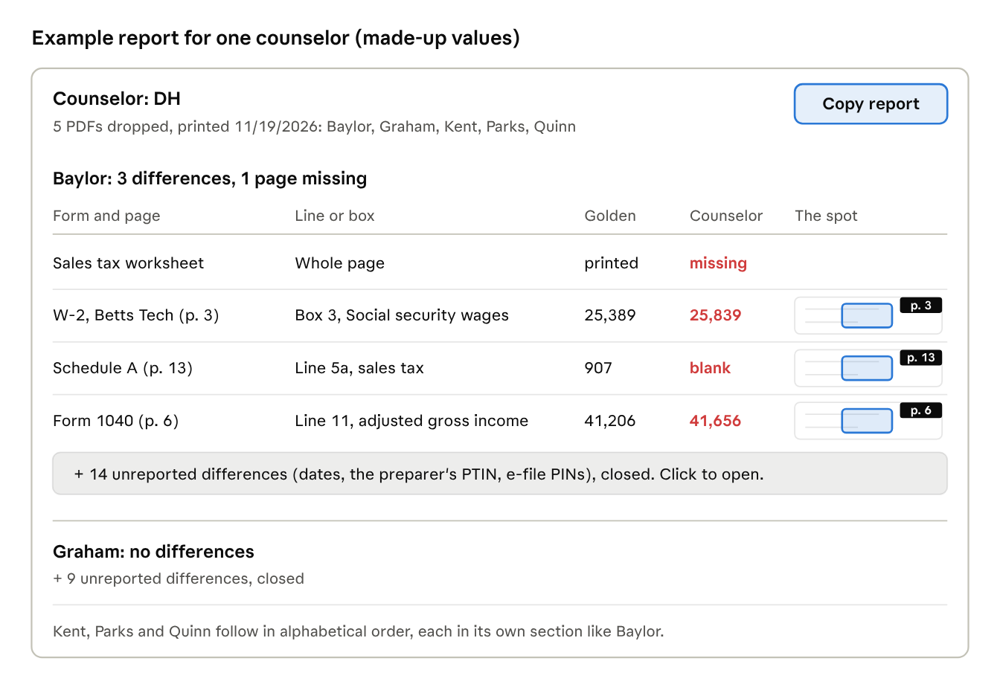
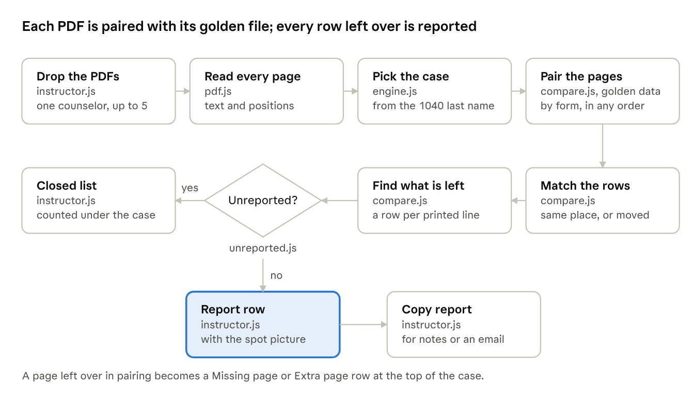
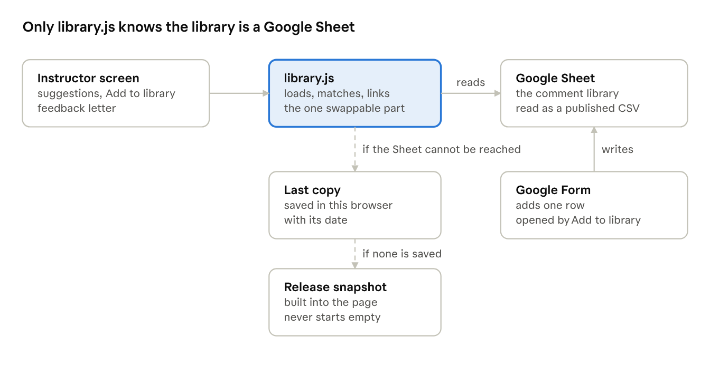

# Audit Pup Architecture

The working copy of this document is the Claude doc "Audit Pup Architecture" (https://claude.ai/artifact/TxNuWciMTLcn2pDoELhMfF). This file is its copy in the repository, kept up to date with each release; the pictures are in `docs/architecture/`.

## Introduction and goals

Audit Pup checks a counselor's TaxSlayer PDF for one step of a practice case against that step's answer key, and shows a hint for every line that is wrong. Instructors use its Instructor mode to compare a counselor's final returns with the golden files. Users are volunteer counselors on Chromebooks, and instructors.

Goals, most important first:

1. **Never mark a wrong line correct.** Exact match only. In Instructor mode, never hide a real difference.
2. **Hints teach.** A hint shows how to find the problem, not how to fix it, and gives the value from the published answer key.
3. **User friendly for all, on a Chromebook.** Easy for every counselor and instructor to understand and use: large print, plain words, few steps, one clear next action.
4. **Free and private.** Runs in the browser: no accounts, no server, works offline.

## Constraints

- **One file, under 10 MB.** The live site is one self-contained web page that can also be downloaded and used offline. A build check fails if the page file reaches 10 MB. Today it is about 4 MB, and each case adds about 0.3 MB.
- **Browsers.** Chrome on Chromebooks, and Safari 15 or newer on Macs.
- **Practice data only.** Every case is made-up TaxSlayer Practice Lab data.
- **Answer keys from the answer sheets.** Imported by a tool, never typed.
- **Known-good code only.** All work is on a dev branch per feature, made from main and kept current with it. A change reaches main only through a pull request whose full test suite passes, and only with the product owner's approval.
- **Release timing.** A merge to main only makes a draft release. Nothing goes live until the product owner reads the release notes and publishes. After each publish, the product owner decides which open dev branches are brought up to date with main.

## Context and scope

In scope: checking PDFs and showing results. Out of scope: TaxSlayer itself, and keeping any record of counselors' scores or reports. Audit Pup stores nothing outside the browser it runs in.

## Building blocks

Arrows point from the user of a part to the part it uses. The step printouts and golden PDFs are not in the page: the tests use them to prove each answer key and reader.

## Control files

These files decide what Audit Pup does, so a person reviews every change to them. Everything else is code that the tests check.

| File | What it decides | Reviewed by |
| --- | --- | --- |
| [source/unreported.js](../source/unreported.js) | The differences Instructor mode leaves out of the rows | Instructors |
| [docs/hints.md](hints.md) | Every hint counselors see, listed for review (made from the case files) | Instructors |
| cases/&lt;case&gt;/answer_sheet.doc | The answer key, imported by a tool | Case author |
| cases/&lt;case&gt;/answer_sheet_corrections.json and the exceptions in case.json | Answer sheet and printout errors the case author confirmed | Case author |
| cases/&lt;case&gt;/&lt;Case&gt;_Golden.pdf | The return Instructor mode compares against | Instructors |
| [docs/release-notes.md](release-notes.md) | What's new and the GitHub release notes | Product owner |
| [docs/chromebook-guide.md](chromebook-guide.md) | The Users Guide | Product owner |
| The passcode, in source/instructor.js | Who can turn on Instructor mode | Product owner |

## How a check runs

**Read each amount:** for every line the step checks (its case file, such as quinn.js, lists them), the engine finds that line's printed label on its form (for example "1a" on Form 1040) and reads the dollar amount printed in the same row.

## How Instructor mode compares a return

An instructor drops a counselor's final PDFs and sees every difference from the golden return, by form and line, in place of the manual PDF compare. Counselors never see Instructor mode.

1. Click **Instructor** at the bottom of the page and enter the passcode. It stays on in that browser until **Leave instructor mode**.
2. Drop one counselor's Quality Review PDFs, up to 5. Each file's case is picked from the 1040 name.
3. While it works, the screen says which file and case it is reading and comparing. Then read the report: one section per case, in alphabetical order, as in the example below.
4. Click **Copy report** to paste it into notes or an email.

Each row is one difference. Missing and extra pages come first. **The spot** is a small picture of that area of the counselor's page, with its PDF page number in the corner, so the instructor sees it in context. Comment suggestions and a feedback letter are planned (Appendix A).

**Repeated differences are one row.** A difference printed on several pages (an address on every form, an amount carried forward) is one row that names its other pages. Pages of the same name, such as four estimate vouchers, are one row. TaxSlayer's notes page is one row showing both sets of notes, since every counselor words notes differently.

**The counselor's name.** The report header shows the counselor's initials from the file names ("DH Quinn.pdf": initials, a space, the case name), or Unknown, and the date each PDF was printed.

**How the comparison works** (`compare.js`):

One TaxSlayer font prints its letters 29 places early; the comparison shifts them back so those pages are compared too.

### Unreported differences

These differences are never shown as rows. Each case lists them in a closed list with a count, so nothing is lost. The instructors own this list; Audit Pup reads it from source/unreported.js, a control file, and this table changes with it.

| Unreported difference | Where it prints | Why it is not reported |
| --- | --- | --- |
| Dates the return was printed, prepared or signed | Summary pages, Form 8879, FTB 8879, consent forms, paid preparer box | They change every time a return is printed |
| Paid preparer details (PTIN, firm, phone) | Form 1040 page 2, California forms | Set by each practice lab account, not entered by the counselor |
| Self-select e-file signature PINs | Form 8879, FTB 8879, consent forms | Any 5 digits the counselor chooses are correct. The IP PIN is still reported |
| Page order | The whole printout | Pages are paired by form, so a different order is not a difference |
| A middle initial added or left out | Names of the taxpayer, spouse and dependents | A middle initial does not matter. First and last names must be spelled exactly, so every other spelling difference in a name or address is reported |

Everything else is reported.

## Deployment

1. Work happens on a dev branch and goes to main through a pull request; GitHub runs the full test suite on it.
2. The product owner approves, and it is merged to main. A new version number makes a **draft** release; nothing is live yet.
3. The product owner clicks **Publish release**. GitHub builds the page from that release, puts it on GitHub Pages, and checks the live site.
4. Open copies of Audit Pup see the yellow update box. Saved progress is kept.

## Crosscutting concepts

- **Read by position.** A value is found by where it sits on the page, next to its line label, not by guessing from the text.
- **One shared engine.** The page and every test load the same `engine.js`, and Instructor mode calls it too, so a fix reaches every use at once.
- **Blank means blank or $0.** An empty answer key cell is checked, not skipped.
- **Progress stays in the browser.** Saved per case on that computer; nothing is sent anywhere.
- **Words in one place.** The Users Guide and What's new are built into the page from `docs/`, so they always match the version.
- **Accessible.** Large print, keyboard use, screen readers, light and dark themes.

## Quality and testing

Testing has its own document: [docs/test-plan.md](test-plan.md). In short, a 4 minute developer test runs on every change and the full suite runs on every pull request. The planted-mistake sweep changes 36,000 single numbers and proves each one fails its check. The compare sweep plants 34,000 differences in the golden files and proves each one is reported, and a real graded counselor's returns prove every instructor comment a PDF can show is in the report (goal 1).

## Glossary

| Word | Meaning |
| --- | --- |
| Case | One practice tax problem (Quinn, Baylor, Graham, Parks, Kent): the taxpayer's story and documents, split into steps the counselor enters in TaxSlayer in order. Its answer sheet gives the correct values after each step |
| Case file | The file for each case (quinn.js, baylor.js and so on) that lists the lines it checks, its steps, its notes, and the hint for each line |
| Step | One stage of a case (A, B, C and so on), with its own correct values |
| Form | A tax form or schedule as TaxSlayer prints it, such as Form 1040, Schedule A, California Form 540, or a W-2. Audit Pup knows each page's form from its printed header |
| Line | One entry Audit Pup checks, such as Form 1040 line 1a, plus where to find it on the page |
| Answer key | The correct value of every line at every step, imported from the case's answer sheet |
| Note | An answer sheet note checked as a whole: filing status and dependents, IP PIN, Preparer Note, or a TS Note box the counselor ticks |
| Hint | The one message under a failed line. It teaches how to find the problem rather than how to fix it, and gives the answer key value from the published key |
| Step printout | TaxSlayer's PDF of one step (`Quinn_Sec_A.pdf` and so on). Used only by the tests, to prove each step's answer key and reading |
| Golden file | The instructors' final printout of a case ("JA &lt;Case&gt; GOLDEN"), kept as `cases/<case>/<Case>_Golden.pdf`. Instructor mode compares counselors' returns with it |
| Golden data | Every readable value on every page of a golden file, with its position, made by a tool as `golden.json` and built into the page |
| Quality Review PDF | TaxSlayer's full printout: the return plus input forms (W-2s, 1099s) and worksheets |
| Unreported difference | A difference on the defined list that instructors never comment on, such as print dates. Counted under each case in a closed list |
| The spot | A small picture of the place on the counselor's page where a difference prints |

## Appendix A: Planned, comment suggestions and the feedback letter

Next, each report row gets suggested comments from a library the instructors keep, and the report becomes a feedback letter. When this is built, its parts move into the main sections and this appendix is deleted.

### What the instructor gets

- Under each row, the library's matching comments, with the counselor's value filled in where a comment says $xxxx. Tick one to use it, edit its words, or write a new one.
- **Add to library** opens the Google Form with the case, form and line already filled in; the instructor types the comment and submits.
- **Copy feedback letter** gives the ticked comments grouped by case and step, in the style of the instructors' comments document.
- **TS Notes checklist:** TaxSlayer does not print TS Notes, so instructors check them live in TaxSlayer. For each case, the screen lists every TS Note the case expects (the case files already name them, for example Graham Steps C, E, F, G, K, L, M and P). The instructor ticks each one Found or Missing, and each missing one adds a comment to the letter.

### The library

- One Google Sheet in a shared Drive folder, owned by the lead instructor (Joanne), with a second owner. The product owner brings its requirements to development. Columns: Case, Form, Line or box, Step, Comment, Status. Instructors edit it freely; Google's version history undoes mistakes.
- New comments come through a Google Form, which always writes the same columns.
- "Publish to web" gives Audit Pup a read-only CSV link. This is Instructor mode's only new internet call.
- **Versions:** the Sheet has a Version tab with a version number and date, which the owner raises after each round of changes. The report header shows the version in use and when it was read, for example "Comment library version 7 (December 2), read just now."
- It starts from the instructors' 2026 comment list. Case comments are checked against this year's golden files, and those that no longer fit are marked **Check before use**.

### How it fits the code

- **`library.js` (new), the one swappable part:** loads the library (columns read by header name, rows it cannot use listed), finds the comments for a report row (same case, form and line; the row already carries all three), and makes the Form link. Moving the library to a database later changes only this file.
- **`instructor.js`:** shows the suggestions, Add to library, and the letter. `compare.js` does not change.
- **Build:** a snapshot of the library goes into each release, so Instructor mode never starts empty.

### Guards and tests

- The Sheet cannot be reached: Audit Pup uses the last copy saved in this browser, else the copy built into the release, and shows a yellow warning on the report, for example "The comment library could not be reached. Using version 6 from November 30, which may be out of date."
- Comments are always shown as plain text, and a library that suddenly shrinks by a lot is flagged.
- Tests: reading the CSV (moved columns, bad rows), every fallback with the network off, the warning when the Sheet cannot be reached, the TS Notes checklist for every case, and counselor DH, where each instructor comment the report shows must match a library row.
